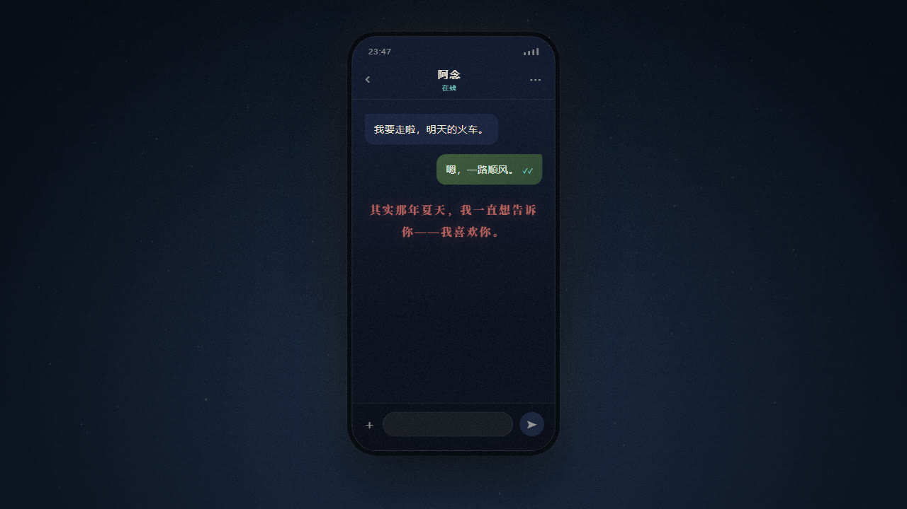
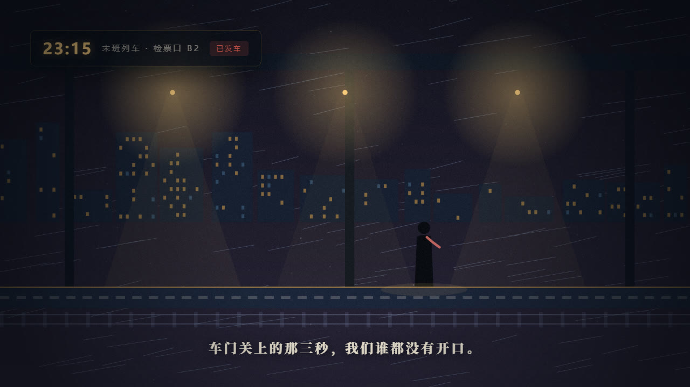
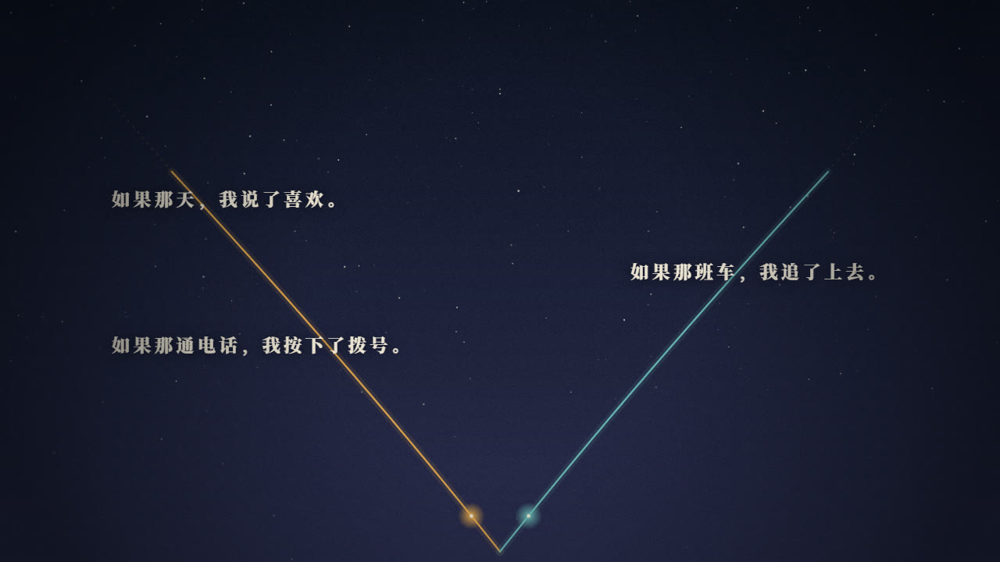

# 遗憾 · REGRET

> 一部关于「错过」的影像诗。未发送的消息、末班列车、褪色的照片、未拨出的电话。
> 动态网页 · 程序化配乐 · 逐帧渲染成片

[](LICENSE)
[](#许可)
[](#成片)

- **在线演示（GitHub Pages）**：<https://chuiziyao.github.io/yihan-regret/>
- **成片下载**：[regret-1080p24.mp4](https://github.com/chuiziyao/yihan-regret/releases/download/v1.0.0/regret-1080p24.mp4)（262.7 MB · H.264 + AAC）
- **本地运行**：克隆后双击 `index.html`，点击「开始放映」。建议佩戴耳机。


---

## 成果展示

### 成片

| 项 | 规格 |
| --- | --- |
| 时长 | 2 分 40 秒（160.0 s，满足「3 分钟之内」） |
| 分辨率 / 帧率 | 1920×1080 / 24 fps |
| 视频编码 | H.264 High@4.1，CRF 22，yuv420p，+faststart |
| 音频编码 | AAC 192 kbps，44.1 kHz 立体声 |
| 配乐 | 程序化作曲：钢琴加性合成 + 垫音 + 多抽头混响 + 场景雨声（numpy 离线合成） |
| 画面来源 | 网页时间轴逐帧 seek 截图 3840 帧（无头 Chrome），与网页逐帧一致 |

下载：[成片 mp4](https://github.com/chuiziyao/yihan-regret/releases/download/v1.0.0/regret-1080p24.mp4) ·
[配乐母带 wav](https://github.com/chuiziyao/yihan-regret/releases/download/v1.0.0/regret-score.wav)（44.1 kHz 立体声）

### 七幕剧照

| 幕 | 剧照 |
| --- | --- |
| 序 · 遗憾 —— 词典式开场 |  |
| 一 · 未发送 —— 删了又写，最后只发出最轻的一句 |  |
| 二 · 末班车 —— 车门关上的三秒，谁都没有开口 |  |
| 三 · 旧照片 —— 五张拍立得依次化作尘光 |  |
| 四 · 未拨出 —— 凌晨 02:14 与三天前的未接来电 |  |
| 五 · 如果 —— 两条分岔的光路 |  |
| 终 · 尾声 —— 尘光升为萤火 |  |

海报帧：[海报.jpg](海报.jpg)

### 网页

- **确定性时间轴引擎**：所有画面（Canvas 插画、DOM 排版、颗粒、雨、萤火）均为时间 `t` 的纯函数，支持逐帧 seek —— 这也是视频能逐帧复现网页的基础。
- **完整播放器**：播放/暂停、进度拖拽（章节刻度 + 悬浮提示）、七章节跳转、静音、全屏、重播、片尾「再看一遍」。
- **WebAudio 实时配乐**：与视频同一份乐谱（和弦进行 + 旋律动机），钢琴/垫音/混响实时合成，雨声随末班车一幕淡入淡出；默认开启，一键静音。
- **响应式**：16:9 电影画框按视口等比缩放；窄屏下播放器自动精简。

| 操作 | 方式 |
| --- | --- |
| 播放 / 暂停 | 空格 或 左下按钮 |
| 快退 / 快进 5 秒 | ← / → |
| 跳转章节 | 「章节」面板，或数字键 1–7 |
| 拖动进度 | 底部进度条 |
| 静音 / 全屏 / 重播 | M / F / R |

---

## 创作提示词

### 用户原始提示词（verbatim）

第一条：

> 这个项目不做限制，你可以充分展示你自己的各种能力。
> 我想让你用「遗憾」这个主题，做一个网页，动态展示。
> 然后把网页内容，保存成的视频，时长3分钟之内都可以，省得我录屏了。
> tokens限制在6000万以内，你要做好规划。

第二条：

> 你能直接把这个网页直接开源到github上，可以吗？
> 把提示词放进去说明，把tokens消耗，成果展示都放进去。

### 提示词 → 创作决策

| 提示词要求 | 落地决策 |
| --- | --- |
| 主题「遗憾」 | 七幕叙事弧：定义 → 爱情（未发送）→ 离别（末班车）→ 记忆（旧照片）→ 亲情（未拨出）→ 假设（如果）→ 和解（尾声）；全部文案原创 |
| 「动态展示」 | 单文件网页 + 确定性时间轴：Canvas 程序化插画（雨夜站台、拍立得、分岔光路）+ DOM 电影排版（手机聊天/拨号界面）+ 胶片颗粒与暗角 |
| 「保存成视频、省得录屏」 | 无头 Chrome 以 `window.__seek(t)` 逐帧截图 3840 帧 → ffmpeg 合成；画面与网页逐帧一致，非实时录屏 |
| 「3 分钟之内」 | 片长 160 s（2:40），24 fps 电影帧率 |
| 「tokens 6000 万以内」 | 实际消耗约 755 万（≈12.6%），见下节；重计算（截图/编码/合成）全部放在本地进程，不消耗 tokens |
| 视觉系统 | 夜靛蓝底 + 琥珀记忆光 + 朱砂情绪色；Noto Serif SC（标题/诗句）+ Long Cang（手写日期）按本片用字定制子集（OFL） |
| 声音 | 一份乐谱、两种实现：网页 WebAudio 实时合成 / 视频 numpy 离线合成，保证视听同步 |

---

## Tokens 消耗

统计快照：2026-11-17 15:44（Asia/Shanghai，v1.0.0 提交前；不含提交调用本身与后续开源维护）。

| 指标 | 数值 |
| --- | --- |
| 模型调用次数 | 55 |
| 输出 tokens | 110,438 |
| 输入 tokens（非缓存） | 3,811,688 |
| 缓存读取 tokens | 3,623,680 |
| **合计（输入 + 输出 + 缓存读取）** | **7,545,806** |
| 预算 | 60,000,000 |
| 预算占用 | ≈ 12.6% |

口径说明：

- 数据来自 DSH 会话日志中每次模型调用的 usage 计数器（`inputTokens / outputTokens / cacheReadTokens / totalTokens`），按「每次调用取一份 usage」去重后累加；快照存于 [`tools/usage.json`](tools/usage.json)，可用 `python tools/session-stats.py` 复算。
- 3840 帧截图、ffmpeg 编码、numpy 配乐合成均为本地计算，**不消耗 tokens**。
- 交互回归测试、逐帧目视质检（约 20 张关键帧读图）已计入上表。

---

## 制作管线（可复现）

```text
index.html（画面 = f(t)）──capture.mjs 逐帧 seek──▶ frames/ 3840 帧 ──┐
                                                                    ├─ ffmpeg ─▶ 遗憾.mp4
tools/score.py（numpy 作曲）──▶ soundtrack.wav ─────────────────────┘
tools/fonts.mjs ──▶ fonts/（Google Fonts 用字子集，OFL）
```

```bash
npm install
node tools/fonts.mjs          # 字体子集
node tools/capture.mjs        # 3840 帧 + 海报（约 5 分钟）
python tools/score.py         # soundtrack.wav
ffmpeg -framerate 24 -i frames/f%05d.jpg -i soundtrack.wav \
  -c:v libx264 -preset slow -crf 22 -pix_fmt yuv420p \
  -c:a aac -b:a 192k -shortest -movflags +faststart 遗憾.mp4
node tools/live-test.mjs      # 播放器交互回归测试
node tools/showcase.mjs       # README 剧照与 GIF 帧
```

## 目录结构

```text
index.html            网页本体（时间轴引擎 + 七幕 + 播放器 + WebAudio）
fonts/                字体子集与 OFL 许可证
docs/img/             七幕剧照 + 速览 GIF
tools/                字体 / 截图 / 配乐 / 展示 / 回归测试 / 用量统计
soundtrack.wav        配乐母带
海报.jpg               片尾海报帧
LICENSE               MIT（代码）
```

## 许可

- **代码与工具**：[MIT](LICENSE)
- **成片、配乐、剧照、海报等原创媒体**：CC BY 4.0（署名「chuiziyao / 《遗憾》」即可复用）
- **字体**：SIL OFL 1.1 —— Noto Serif SC © 2012 Google Inc.；Long Cang © 2018 The Long Cang Project Authors。许可证见 `fonts/OFL-NotoSerifSC.txt`、`fonts/OFL-LongCang.txt`

## 致谢

DeepSeek Harness · Headless Chrome · ffmpeg · numpy · Google Fonts